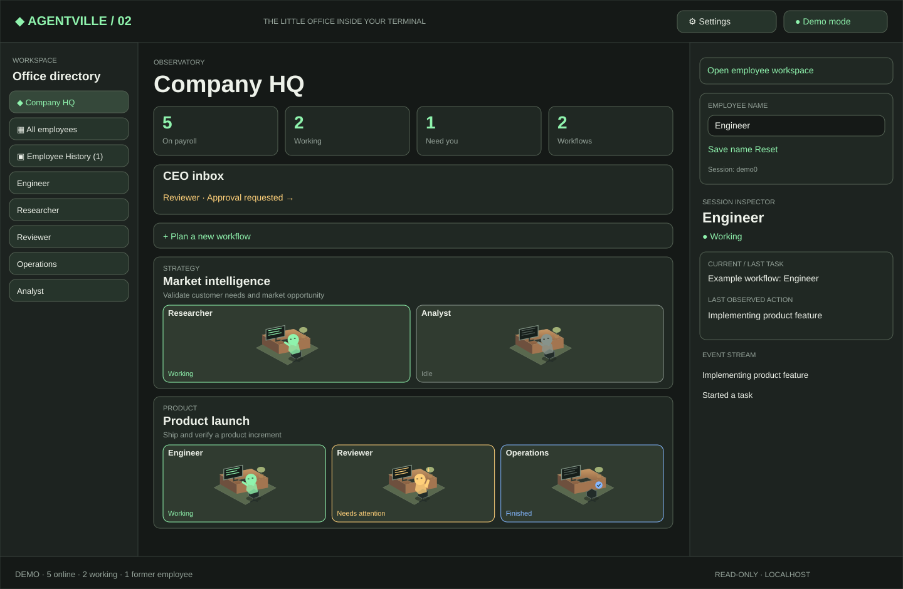

# Agentville

**One person. An entire company.**

## Why I built this

Once I started using Codex for different projects, I realized that running more agents is much easier than keeping track of them. A few Terminal windows quickly become a context-switching problem: which agent is working on what, which one is waiting for me, and what happened to the work when a session ended?

I thought it would be fun to represent those processes as a little company — with employees, departments, roles, and an office I could actually look at. Agentville is a visual headquarters for local Codex sessions, with a place to keep project context and see which agents need attention.



*Illustrated preview of the current Company HQ interface using the app’s actual workstation graphics and demo roles.*

## Meet your new company headquarters

Every detected Codex process becomes a potential employee. Give it a role, assign it to a workflow, and inspect its activity from one place. When a monitored process leaves, its record moves into Employee History.

| Your question | Agentville answers |
|---|---|
| Who is online? | Local Codex process discovery |
| What are they doing? | Recognized activity and optional task excerpts |
| Who needs me? | CEO inbox of observed approval requests |
| Is this project staffed? | Department and workflow seats |
| What got done? | Recent events and former employee records |

## Try it in two minutes

Requires Node.js 18+; live monitoring is designed for macOS with Codex CLI and lsof.

```sh
git clone https://github.com/zhen01/Agentville.git
cd Agentville
npm start
```

Open **[http://localhost:4317](http://localhost:4317)**. Explore the sample company in Demo mode, then switch to Live mode while Codex runs in separate terminals.

1. Create a workflow with a department, outcome and roles.
2. Assign detected employees to the seats you need filled.
3. Inspect their activity and check your CEO inbox.
4. Review departed employees in Employee History.

Open **Settings → Show task text** to reveal task excerpts in Live mode. This is off by default and the preference is saved in your browser. Turning it off hides the excerpts again. Task text is fetched on demand from linked logs and is not added to new employee history records. Excerpts may contain sensitive information; avoid enabling them on shared screens.

## Built for the one-person company

For developers, founders and independent builders working across concurrent agent sessions. The goal is to reduce context switching and make ownership, attention and progress visible.

## What ships today — v0.4

### Your founding team

| Role | Responsibility |
|---|---|
| Researcher | Understand the customer and gather evidence |
| Analyst | Turn evidence into decisions |
| Engineer | Build the product |
| Reviewer | Check quality and acceptance criteria |
| Operations | Maintain delivery and operational documentation |

### Employee workspace

Open any employee's workspace to review or edit Tasks, Project, Agents, Decisions, Deliverables, Handoff and Lessons. Markdown checklists support `[ ]` (to do), `[~]` (in progress) and `[x]` (done). Documents are persisted in browser storage per workflow role; replacing a session does not erase that role's notes. Import existing Markdown files using the file picker and export saved documents to your project. These are manually maintained documents, not automatic filesystem synchronization.

### Keep a shift alive

Use tmux manually on macOS (`brew install tmux` if needed). Start a named session with `tmux new -s engineer`, then launch Codex normally inside it. Detach with Ctrl+B followed by D; return using `tmux attach -t engineer`. Closing a terminal does not stop a detached tmux session, but shutting down the Mac does. Agentville monitors detected processes without starting or stopping them. Before changing sessions, save a handoff and export the relevant documents to your project; review them with the next session.

- Animated office and workflow rooms with configurable roles.
- Live process detection, best-effort session-log linking and event inspection.
- Workflow plans and staffing persisted in browser storage.
- Local employee departure history (last 500 observed departures).
- Separate demo and live workspaces; no extra API keys or dependencies.

This is an early read-only observability MVP. Staffing does not launch agents or dispatch tasks. Approvals remain in Codex. Process-to-session linking relies on open log files and may vary by CLI version; unlinked processes are explicitly identified. Activity states are inferred, and elapsed time represents online duration, not productive work time.

## Under the hood

Node.js HTTP server · native JavaScript and SVG · process inspection via ps and lsof · JSONL session events · local JSON history.

The server binds to loopback only. It polls every three seconds and reads local Codex session logs from `~/.codex/sessions` (or `$CODEX_HOME/sessions`). Archive records are stored in `~/.agentville/employee-history/roster.json`. Prompt text is hidden by default. Do not expose the server publicly or share sensitive live screens.

## Development

```sh
npm test
```

Roadmap: better session correlation, richer project-level progress, clearer attention signals, and more expressive office animations.

**Make invisible computation visible.**
