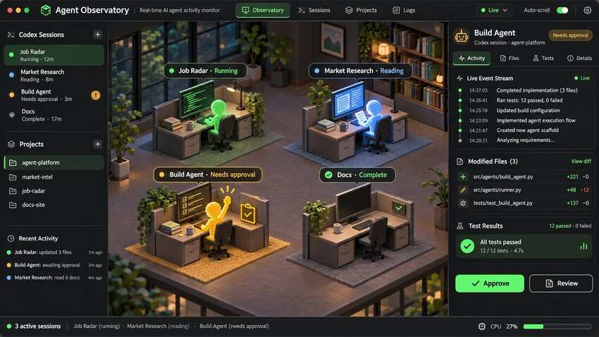

# Agentville

**One person. An entire company.**

Your AI workforce deserves more than a dozen terminal tabs. Agentville is a local-first visual headquarters for people running multiple Codex agents: organize projects into departments, staff workflows, and see who needs your attention.



*Design concept — the visual direction for Agentville, not a screenshot of the current MVP.*

## Meet your new company headquarters

Every detected Codex process becomes a potential employee. Give it a role, assign it to a workflow, and inspect its activity from one place. When a monitored process leaves, its record moves into Employee History.

| Your question | Agentville answers |
|---|---|
| Who is online? | Local Codex process discovery |
| What are they doing? | Recognized activity and optional task excerpts |
| Who needs me? | CEO inbox of observed approval requests |
| Is this project staffed? | Department and workflow seats |
| What got done? | Recent events and former employee records |

## Try it in two minutes

Requires Node.js 18+; live monitoring is designed for macOS with Codex CLI and lsof.

```sh
git clone https://github.com/zhen01/Agentville.git
cd Agentville
npm start
```

Open **[http://localhost:4317](http://localhost:4317)**. Explore the sample company in Demo mode, then switch to Live mode while Codex runs in separate terminals.

1. Create a workflow with a department, outcome and roles.
2. Assign detected employees to the seats you need filled.
3. Inspect their activity and check your CEO inbox.
4. Review departed employees in Employee History.

For optional task excerpts, start with `AGENTVILLE_SHOW_TASK_TEXT=1 npm start`. These excerpts may contain sensitive information and may be saved locally in history.

## Built for the one-person company

For developers, founders and independent builders working across concurrent agent sessions. The goal is to reduce context switching and make ownership, attention and progress visible.

## What ships today — v0.3

- Animated office and workflow rooms with configurable roles.
- Live process detection, best-effort session-log linking and event inspection.
- Workflow plans and staffing persisted in browser storage.
- Local employee departure history (last 500 observed departures).
- Separate demo and live workspaces; no extra API keys or dependencies.

This is an early read-only observability MVP. Staffing does not launch agents or dispatch tasks. Approvals remain in Codex. Process-to-session linking relies on open log files and may vary by CLI version; unlinked processes are explicitly identified. Activity states are inferred, and elapsed time represents online duration, not productive work time.

## Under the hood

Node.js HTTP server · native JavaScript and SVG · process inspection via ps and lsof · JSONL session events · local JSON history.

The server binds to loopback only. It polls every three seconds and reads local Codex session logs from `~/.codex/sessions` (or `$CODEX_HOME/sessions`). Archive records are stored in `~/.agentville/employee-history/roster.json`. Prompt text is hidden by default. Do not expose the server publicly or share sensitive live screens.

## Development

```sh
npm test
```

Roadmap: better session correlation, richer project-level progress, clearer attention signals, and more expressive office animations.

**Make invisible computation visible.**
